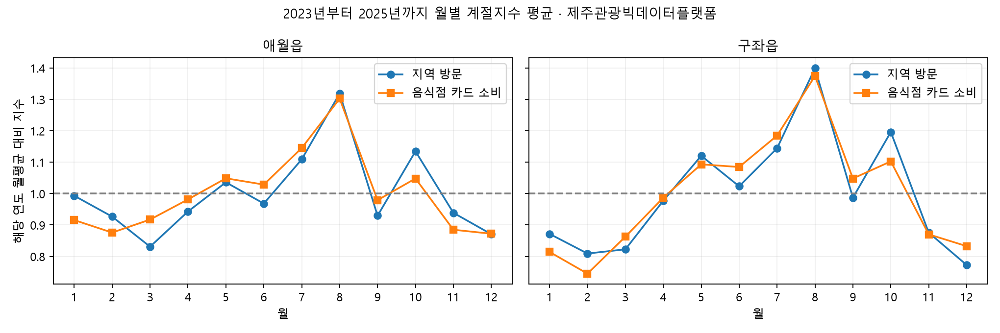

# 제주 관광 데이터 수집 및 초기 분석 보고서

작성·수집 기준일: 2026년 10월 27일

## 1. 확보한 자료와 분석 범위

계획서의 제주관광빅데이터플랫폼 데이터 픽 49개 화면에 대응하는 CSV를 확보했다. 서로 같은 원자료를 제공하는 화면이 있어 화면 수와 파일 수는 다르다. 동일 해시의 재다운로드를 제외한 파일은 45개이며, 더 짧은 기간으로 받은 2개를 제외하면 분석 대표 파일은 43개다. 대표 파일의 합계는 9,374,558행, 743,310,833바이트다. 다른 화면에서 같은 관측을 다시 제공하므로 이 행 수를 고유 사람 수나 거래 수로 해석하면 안 된다.

추가로 자료실 게시물 9건의 첨부파일 11개를 확보했다. 2024년과 2025년 방문관광객 실태조사의 내국인·외국인·크루즈 응답 자료 6개, 총 24,112행을 포함한다. 설문은 열 구조·월 범위·가중값의 결측 및 양수 여부까지만 검증했다. 문항 정의와 조사 설계 확인 전에는 가중 만족도나 인과효과를 산출하지 않았다.

이 보고서는 플랫폼 자료의 기술통계와 시연 데이터 준비 결과다. 타 기관의 모든 공공데이터 수집, 사업체 사용 평가, 캠페인 실행 성과 검증은 완료 범위에 포함하지 않는다.

| 핵심 자료 | 제공 기간의 관측 범위 | 분석 역할 |
| --- | --- | --- |
| 읍면동 방문객, regSn 21 | 2019년 1월부터 2026년 8월까지 | 43개 읍면동의 계절성·동기간 비교 |
| 지역별 카드 소비, regSn 27 | 2020년 1월부터 2026년 9월까지 | 음식점 소비 계절성·고객 구성 |
| 시간대별 카드 소비, regSn 39 | 2020년 1월부터 2026년 9월까지 | 월·고객구분별 음식점 소비 시간대 |
| 음식점 세부업종, regSn 82 | 2020년 1월부터 2026년 9월까지 | 도민 커피 전문점 소비 참고 |
| 내비게이션 인기 장소, regSn 48 | 2021년 1월부터 2026년 9월까지 | 애월·구좌의 장소 후보 |
| 월별 입도객, regSn 17 | 2001년 1월부터 2026년 8월까지 | 제주 전체 관광 흐름 |

전체 파일의 출처·해시·행 수·결측·중복 진단은 [수집 목록](../07_원천/ijto_20261027/download_inventory.json), 화면별 이용허락 표시와 대응 파일은 [출처 목록](../07_원천/ijto_20261027/source_catalog.json)에 기록했다. 원본 CSV와 보고서·응답자 단위 파일은 로컬 수집 폴더에 보관하고 Git에는 넣지 않았다.

## 2. 계산 방법과 검증

계절지수는 각 지역·연도의 월 관측값을 해당 연도 12개월 평균으로 나눈 뒤, 2023년부터 2025년까지 3개 연도의 지수를 평균한 값이다. 1보다 작으면 해당 연도의 월평균보다 낮다는 뜻이다. 연도별 최솟값·최댓값은 관측 범위이며 통계적 신뢰구간이 아니다. 월별 일수 차이를 줄이기 위해 월 관측값을 달력 일수로 먼저 나눈 지수도 별도로 계산했다.

지역 방문객과 카드 소비는 서로 다른 모집단이다. 두 지수의 계절적 동행만 비교하며, 소비액을 방문객으로 나눈 값을 실제 객단가로 제시하지 않는다. 음식점 지수에는 도민·내국인 관광객·외국인 관광객이 모두 포함된다. 고객 구성도 사람 수가 아닌 카드 소비금액 비중이다.

| 검증 | 결과와 처리 |
| --- | --- |
| 방문객 지역·월 키 및 내·외국인 합계 | 중복 키 없음, 구성 합계 일치 |
| 계절성 기준 연도 | 모든 분석 지역에서 연도별 12개월 확보 |
| 지역 카드 합계와 제주 전체 소비 통계 | 월·고객구분·업종 1,215개 그룹 대조, 최대 차이 58원, 최대 상대오차 약 0.0000121% |
| 시간대 소비 합계와 지역 카드 소비 | 48,598개 그룹 대조, 누락 없음, 최대 차이 18원 |
| 행정구역 결합 | 방문·카드·내비게이션의 서로 다른 코드를 지역명으로 검증하여 43개 지역 일대일 매핑 |
| 시연 데이터 | 43개 지역·516개 계절성 행, 각 지역 12개월, 계절지수 평균 1 및 고객 구성비 합계 100% 검증 |
| 원본 보존 | 다운로드 CSV 45개 SHA-256 검증, 원본 행 임의 삭제 없음 |

소비 CSV의 같은 열 값이 반복되는 행을 자동 삭제하지 않았다. 모든 행을 합산한 결과가 별도 제공되는 제주 전체 통계와 일치하기 때문이다. 반올림과 유사한 작은 차이가 관측되지만, 차이의 원인을 원천 제공자가 확인한 것은 아니다.

검증 상세: [원천 검사](../06_증빙/ijto_20261027/validation_checks.json), [패키지 검사](../06_증빙/ijto_20261027/delivery_validation.json), [소비 대조](../06_증빙/ijto_20261027/card_reconciliation.json)

## 3. 주요 결과와 마케팅 캘린더 적용

| 항목 | 애월읍 | 구좌읍 |
| --- | --- | --- |
| 방문 지수가 낮은 3개 월, 낮은 순서 | 3월 0.831, 12월 0.871, 2월 0.927 | 12월 0.773, 2월 0.809, 3월 0.823 |
| 일수 보정 후 낮은 3개 월 | 3월, 12월, 9월 | 12월, 3월, 1월 |
| 12월 음식점 소비 지수 | 0.872 | 0.833 |
| 2025년 음식점 소비 중 내국인 관광객 비중 | 66.6% | 71.7% |
| 2025년 음식점 소비 중 도민 비중 | 25.2% | 21.6% |
| 2025년 음식점 소비 중 외국인 관광객 비중 | 8.2% | 6.7% |
| 2026년 1월부터 8월까지 방문객, 전년 같은 기간 대비 | +3.65% | -2.96% |

구좌는 12월을 우선 검토할 비수기 사례로 삼을 수 있다. 애월은 3월과 12월을 나눠 살피는 편이 적절하다. 월 총량에서 낮게 보이는 2월은 일수가 짧은 영향이 있으므로 화면에서 월 총량 지수와 일평균 지수를 선택할 수 있어야 한다.

두 지역의 12월은 방문과 음식점 소비가 모두 연평균 아래다. 따라서 12월 캠페인 준비의 과거 근거로 사용할 수 있다. 다만 실제 할인율·상품·광고 대상 선정은 매장 업종과 가격, 영업시간, 고객 평가로 검증해야 한다. 이 자료만으로 매출 증가를 보장하거나 특정 가게에 효과가 있었다고 표현하지 않는다.

전년 같은 달의 방문객을 그대로 예측값으로 사용하는 단순 기준선의 2025년 WAPE는 애월 약 9.81%, 구좌 약 9.87%다. 이는 비교 기준선의 과거 오차이며, 새 예측모델의 성능이나 2026년 예측 정확도가 아니다.

제주 전체 월별 입도 확정 통계의 1월부터 8월까지 합계는 2025년 8,983,891명, 2026년 9,351,931명이다. 제주 전체 증가를 모든 읍면동의 증가로 일반화하면 안 된다.

시간대 소비 분포는 월·고객구분을 선택하는 근거 카드로, 장소 자료는 동일 연도 안에서 관광객 도착 수가 많은 후보를 찾는 참고 자료로 제공했다. 이동경로·거리·제휴 여부는 분석하지 않았으므로 ‘인근 협력업체’나 ‘최적 동선’으로 표시하면 안 된다.

## 4. 발견한 제한과 제출 전 조치

1. **카페 세부업종 범위:** regSn 82의 실제 다운로드에는 ‘도민’만 있다. 관광객 카페 매출 또는 읍면동 카페 매출로 사용하지 않는다. 지역 분석은 음식점업 전체임을 명시한다.
2. **내비게이션 구성 불일치:** 1,616,285행 중 110,389행에서 전체 도착 수와 도민·관광객 합계가 다르며 최대 차이는 217이다. 원본을 수정하지 않고 관광객 도착 열을 별도로 사용한다. 관련 후보에는 원천 경고를 유지한다. 2026년 집계 기준 변경 주의사항에 따라 연도 간 증감률도 만들지 않았다.
3. **비짓제주 로그:** 1,678,425행 중 완전히 같은 값의 반복 행이 507,630행이다. 반복의 원인과 ‘수치’의 정의가 확정되지 않아 검색량·인기도 순위의 핵심 근거에서 제외했다.
4. **실태조사:** 확보한 응답 데이터는 문항 코드·가중 설계 검증이 남아 있다. 설문 요약의 여행경비도 관광객 구분별 통화·단위를 확인하기 전 서로 비교하지 않는다.
5. **공개 이용허락:** 출처별 공공누리 표시가 다르거나 비어 있다. 다운로드 성공은 모든 원본의 재배포 허가를 의미하지 않는다. 공개 시연 배포 전 출처 목록의 미확인 항목과 파생 데이터 공개 조건을 확인한다.
6. **활용 성과:** 실제 사업체의 사용 평가나 캠페인 결과는 아직 없다. 분석·프로토타입 기능 구현과 실제 성과를 제출 문서에서 구분해야 한다.

데이터 문의가 필요할 때 확인할 내용은 regSn 82의 관광객 자료 제공 여부, regSn 22 반복 행의 집계 차원, regSn 48 구성 불일치의 원인, 공개 시연에서 파생 통계 제공 가능 범위다. 이번 작업에서 문의 메시지를 발송하지 않았다.

## 5. 시연용 데이터와 다음 구현 단계

[시연용 JSON](../02_제품/데이터/ijto-demo-20261027.json)에 실제 자료로 계산한 지수·고객 구성·동기간 변화와 애월·구좌의 시간대 분포·장소 후보를 담았다. 출처, 자료 기간, 계산법, 경고, 코드 매핑도 포함한다. [필드 설명 및 화면 적용 규칙](../02_제품/데이터/README.md)을 함께 제공한다.

후속 보완으로 **구좌 음식점의 월별 실제 데이터 사례를 기존 프로토타입 진입점에 연결했다**. 기존 화면은 예시임을 표시하고 실제 자료 사례로 이동하는 링크를 제공한다. 사례 화면은 월·고객군 선택 → 안정성 확인 → 고객 구성·시간대·장소 근거 → 계획 저장·내보내기로 이어진다. 매출 효과와 사용 평가는 ‘미측정’으로 유지한다. 초기 범용 JSON과 별도로 실제 사례용 `화면시안_Make/evidence/case-data.json`을 사용한다.

재실행 방법과 원본 위치는 [수집·분석 실행 안내](../07_원천/ijto_20261027/README.md)에 정리했다. 숫자·JSON 구조·그래프 표시를 검증했으며, 초기 분석의 화면 검증 범위는 그래프였으며, 아래 후속 사례는 브라우저에서 별도 검증했다. 공개 사이트 배포 성공 여부는 로컬 시연 검증과 구분한다.

## 6. 후속 보완: 안정성과 구좌 12월 사례

43개 읍면동의 12개월, 총 516개 조합에 대해 2023년부터 2025년까지 연도별 일수 보정 방문·음식점 소비 지수를 계산했다. 두 지수가 세 해 모두 1 미만이고 두 평균 지수가 각각 0.95 이하일 때 ‘일관된 낮은 수요’로 분류한다. 0.95는 운영상 검토 기준이며 통계적 유의수준이 아니다. 0.90·0.95·1.00의 기준 변경 결과도 기록했다. 원천 관측값의 추정 오차까지 검증한 것은 아니다.

구좌 12월의 방문 일평균 지수는 **0.760**, 음식점 소비 일평균 지수는 **0.819**이며 세 해 모두 두 지수가 평균보다 낮다. 0.90·0.95·1.00 기준에서 모두 낮은 수요로 분류된다. 월 총량 지수 0.773·0.833과 구별해서 표시한다.

| 구좌 12월 고객군 | 2025년 12월 소비금액 비중 | 3개 연도 일수 보정 소비 지수 |
| --- | --- | --- |
| 내국인 관광객 | 67.04% | 0.783 |
| 도민 | 24.78% | 0.921 |
| 외국인 관광객 | 8.18% | 0.859 |

도민 소비가 상대적으로 덜 낮아지는 양상은 확인되지만 도민 대상 광고의 효과가 더 크다는 뜻은 아니다. 시연은 고객군을 자동 확정하지 않고 운영자가 선택 이유를 기록하게 한다.

시간대는 해당 월의 3개 연도 소비를 합산한 비중과 연도별 비중 범위를 함께 제공한다. 구좌 12개월·3개 고객군·24개 시간대의 864칸 중 원천 관측이 없는 49칸은 null로 유지했다. 누락을 0건으로 채우지 않으며, 비중의 분모는 관측된 소비금액이다. 고객군 분석은 구좌에 한정했으며, 다른 지역의 일부 고객군은 12개월이 완전하지 않아 동일 분석을 자동 확장하지 않았다.

장소는 연간 누적 후보를 해당 월 후보로 바꿨다. 2023년부터 2025년까지 같은 월에 모두 관측된 구좌 관광지 유형을 추려 관광객 도착 합계로 정렬한다. 12월 상위 후보는 비자림, 스누피가든, 김녕해수욕장, 용눈이오름, 김녕미로공원이다. 원천 구성 불일치 행 수를 각 후보에 표시한다. 현재 영업·접근성·매장과의 거리·제휴 관계는 확인되지 않았고, 장소는 선택한 소비 고객군별 자료가 아니다.

### 안정성의 한계 확인

한 해를 제외한 두 해로 판정한 뒤 제외한 해에서도 두 지수가 1 미만인지 확인했다. 2023년 제외 시 75건 중 47건(62.7%), 2024년 제외 시 59건 중 47건(79.7%), 2025년 제외 시 65건 중 44건(67.7%)이 일치했다. 이는 전체 516건에 대한 정확도가 아니라 **분류된 사례 중 제외 연도에서도 낮았던 비율**이다. 일부 검증은 제외 연도보다 뒤의 자료를 참고하므로 과거 패턴의 안정성 점검이며 미래 예측 성능이 아니다. 모든 지역의 평균 지수를 확정적 비수기로 표현할 수 없다는 한계가 남는다.

### 실행·검증 상태

- 기존 두 시안의 ‘실제 데이터로 구좌 12월 계획하기’ 링크에서 사례로 이동 가능
- 12월과 8월의 판정 차이, 고객군 선택, 계획 저장·새로고침 복원, 기존 Make 시안 왕복을 실제 브라우저에서 확인
- 내보내기 화면의 JSON에서 대상 월·고객군·공식 출처 4개·미측정 성과의 null 값을 확인
- 브라우저의 파일 다운로드 완료는 확인되지 않아 JSON 복사 대안을 제공하며 화면에는 ‘파일 저장 요청’으로 표시
- 잘못된 스키마·중복 월·잘못된 시간대·비중 오류를 차단하는 자동 검사 통과
- 데스크톱 화면 표시 확인, 모바일 실기기 및 실제 사업자 평가는 미실시

[사례 실행 안내](../02_제품/화면시안_Make/evidence/README.md), [분석 검증](../06_증빙/ijto_20261027/case_validation.json), [전체 안정성](../06_증빙/ijto_20261027/stability_by_region_month.json)

## 7. 동기간·시간 구간·규칙 비교 추가 분석

2026년 방문(regSn 21), 음식점 소비·이용건수(regSn 27), 시간대 소비·이용건수(regSn 39)가 모두 있는 **1월부터 8월까지**를 2025년 같은 기간과 비교했다. 원본 SHA-256을 확인하고 모든 고객군의 월 포함 여부를 검사했다. 방문은 지역 집계이고 카드 이용건수는 고유 고객 수가 아니다. 소비는 물가 보정 전 명목금액이다.

| 지표 | 2025년 동기간 | 2026년 동기간 | 증감률 |
| --- | --- | --- | --- |
| 방문 집계(명) | 4,713,366 | 4,573,686 | -2.96% |
| 음식점 소비(원) | 45,370,183,178 | 43,269,525,794 | -4.63% |
| 이용건수(건) | 1,402,422 | 1,313,471 | -6.34% |

| 고객군 | 소비 증감률 | 이용건수 증감률 |
| --- | --- | --- |
| 내국인 관광객 | -12.37% | -14.61% |
| 도민 | +0.87% | +0.65% |
| 외국인 관광객 | +67.82% | +57.30% |

내국인 관광객 감소와 외국인 증가가 상쇄되어 전체 지표만으로 고객군을 결정하기 어렵다. 외국인은 전년 규모가 작으므로 증가율만으로 마케팅 우선순위를 확정하지 않는다. 2026년 12월 실적은 없으며 이 증감률을 12월 예상 매출로 대입하지 않는다.

### 시간 구간 분석

새벽(0시부터 5시), 아침(6시부터 10시), 점심(11시부터 14시), 오후(15시부터 17시), 저녁(18시부터 21시), 야간(22시부터 23시)으로 금액과 이용건수 비중을 함께 계산했다. 아래는 2023년부터 2025년까지 12월 내국인 관광객 합산이다.

| 시간 구간 | 금액 비중 | 건수 비중 | 관측 시간칸 / 예상칸 |
| --- | --- | --- | --- |
| 새벽 | 0.53% | 0.23% | 13 / 18 |
| 아침 | 8.76% | 10.16% | 14 / 15 |
| 점심 | 46.03% | 50.43% | 12 / 12 |
| 오후 | 21.13% | 24.58% | 9 / 9 |
| 저녁 | 22.41% | 13.95% | 12 / 12 |
| 야간 | 1.14% | 0.66% | 6 / 6 |

구간은 분석 편의상 정했으며 광고·할인 최적 시간의 검증 결과가 아니다. 비중의 분모는 관측 합계이고 누락을 0으로 대체하지 않았다. 화면에는 대상 월의 과거 시간 구간과 최근 1월부터 8월까지의 시간 구간을 구분한다. 시간대 자료와 지역별 자료를 48개 연도·월·고객군 조합으로 대조했을 때 금액 최대 6원, 건수 최대 7건 차이가 있다. 원인을 확정하지 않고 원본을 유지했다.

### 비수기 규칙의 시간순 비교

2023·2024년 자료로 2025년 516개 지역·월을 비교했다. 실제 낮은 사례는 해당 연도 두 일수 보정 지수가 모두 1 미만인 182건이다. 전년도 규칙은 2024년을 사용한다. 현재 화면의 3개 연도 반복 조건을 과거 비교에서는 이용 가능한 2개 연도로 적용했으므로 완전히 같은 학습 길이의 검증은 아니다.

| 기준 | 후보 | 실제 낮음(TP) | 잘못 선정(FP) | 놓침(FN) | 적중 비율 | 발견 비율 |
| --- | --- | --- | --- | --- | --- | --- |
| 전년도 두 지수 1 미만 | 188 | 106 | 82 | 76 | 56.38% | 58.24% |
| 전년도 두 지수 0.95 이하 | 83 | 51 | 32 | 131 | 61.45% | 28.02% |
| 2개 연도 반복 + 평균 0.95 이하 | 65 | 44 | 21 | 138 | 67.69% | 24.18% |

보수적 규칙은 적중 비율을 높이는 대신 많은 낮은 수요 사례를 놓친다. 이는 전체 정확도·마케팅 성공률이 아니다. 평가 연도는 1개뿐이며 현행 개정 자료를 사용해 당시 제공 지연을 재현하지 못했다. 2025년 연평균으로 평가 정답을 정의하므로 사후 비교다. 0.95 기준의 우월성을 확정하거나 2026년 성과를 예측하지 않는다.

### 사용자 검증과 제출 범위

[평가 절차](../06_증빙/사용자평가/평가_진행절차.md), [개별 기록](../06_증빙/사용자평가/개별_평가기록_양식.md), [집계 양식](../06_증빙/사용자평가/결과_집계_양식.md)을 준비했다. 실제 평가는 아직 미실시다. 현재 산출물은 데이터 기반 계획 지원 시연이며 사업체 매출 개선 사례로 표현하지 않는다.

[규칙 비교 원자료](../06_증빙/ijto_20261027/rule_benchmark_2025.json), [동기간 계산](../06_증빙/ijto_20261027/gujwa_2026_matched_period.json).
