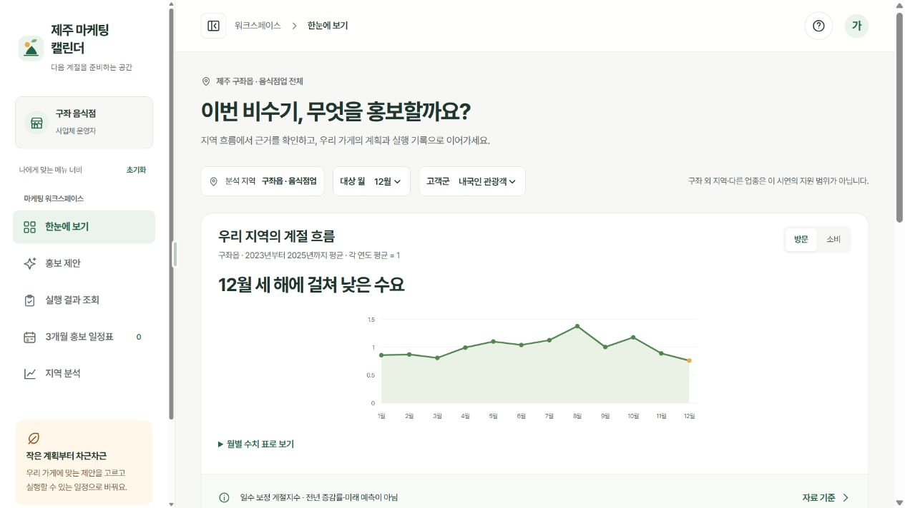
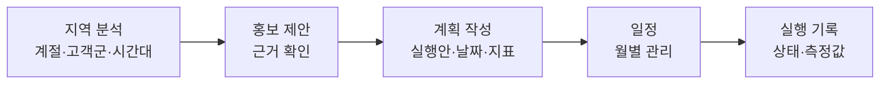
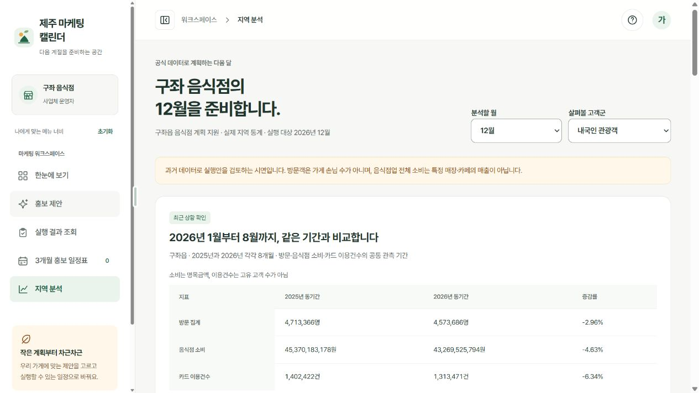
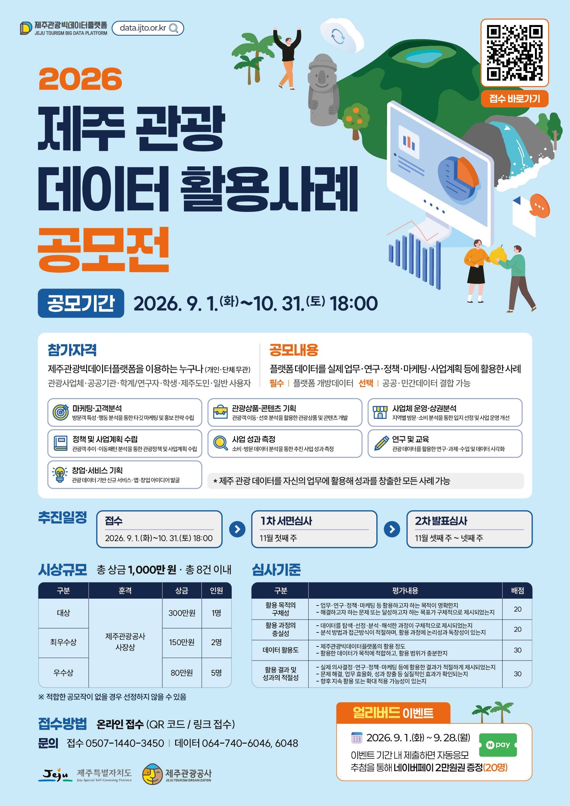

<div align="center">

# 제주 비수기 상권 마케팅 캘린더

**공식 관광 데이터로 우리 지역의 비수기를 확인하고, 홍보 계획과 실행 기록까지 이어 주는 소상공인용 프로토타입**

2026 제주 관광 데이터 활용사례 공모전 출품용 프로젝트

[](https://nenongkim.github.io/jeju-marketing-demo/)
[](05_리서치/20261027_실제데이터_수집과_분석.md)
[](05_리서치/20261028_전체작업_요약.md)

</div>



## 프로젝트 소개

비수기 홍보를 준비하는 소규모 사업자는 지역 수요가 언제 낮아지는지, 어떤 고객군을 살펴봐야 하는지 확인하기 어렵습니다. 이 프로젝트는 제주관광빅데이터플랫폼의 실제 통계를 근거로 다음 흐름을 한 화면에서 잇습니다.



| 항목 | 내용 |
| --- | --- |
| 지원 범위 | 제주 구좌읍 음식점업, 2026년 12개 월, 고객군 3개(내국인 관광객·외국인 관광객·도민) |
| 활용 분야 | 창업·서비스 기획, 마케팅·고객분석 |
| 필수 데이터 | 제주관광빅데이터플랫폼 개방데이터 |
| 저장 방식 | 입력한 계획과 기록은 사용자의 브라우저에만 저장 |

## 시연 방법

1. [평가용 시연 사이트](https://nenongkim.github.io/jeju-marketing-demo/)에 접속합니다.
2. 첫 화면에서 **계정 정보 채우기 → 로그인**을 누릅니다. 로그인은 시연용이며 실제 가입이나 서버 인증이 아닙니다.
3. **한눈에 보기 → 지역 분석·홍보 제안 → 계획 작성 → 일정 → 실행 기록** 순서로 사용합니다.



## 데이터와 분석 결과

플랫폼 데이터 픽 49개 화면에 대응하는 CSV를 확보해 2026년 10월 27일 기준으로 분석했습니다. 이 가운데 다음 4개 자료를 핵심 근거로 사용합니다.

| 플랫폼 자료 | 사용 목적 |
| --- | --- |
| regSn 21 읍면동 방문 집계 | 지역·월 계절성, 최근 같은 기간 변화 |
| regSn 27 지역별 카드 소비 | 음식점 소비금액·이용건수, 고객군별 구성과 변화 |
| regSn 39 시간대 카드 소비 | 고객군별 시간 구간의 소비금액·이용건수 비중 |
| regSn 48 내비게이션 목적지 방문 | 대상 월에 관측된 구좌 관광지 후보 |

**구좌읍 12월 계절성** (2023년부터 2025년까지 평균, 연평균 = 1)

- 방문 일평균 지수 **0.760**, 음식점 소비 일평균 지수 **0.819**
- 세 해 모두 두 지수가 연평균보다 낮게 관측됨

**구좌읍 최근 같은 기간 비교** (각 연도 1월부터 8월까지)

| 지표 | 2025년 | 2026년 | 증감률 |
| --- | ---: | ---: | ---: |
| 방문 집계 | 4,713,366명 | 4,573,686명 | −2.96% |
| 음식점 소비 | 45,370,183,178원 | 43,269,525,794원 | −4.63% |
| 카드 이용건수 | 1,402,422건 | 1,313,471건 | −6.34% |

수치를 읽을 때 주의할 점입니다.

- 계절지수는 해당 연도 월평균과의 비교값이며 전년 대비 증감률이나 미래 예측이 아닙니다.
- 방문 집계는 개별 가게의 손님 수가 아니고, 음식점 소비는 특정 매장의 매출이 아닙니다.
- 실제 사업자 평가, 업무시간 절감, 매출 증가 효과는 아직 측정하지 않았습니다.

## 저장소 구성

| 폴더 | 내용 |
| --- | --- |
| [`00_제출`](00_제출) | 프로젝트 정의서, 유스케이스, 화면설계서, 공모전 참가 서류 |
| [`02_제품`](02_제품) | 화면 시안과 통합 프로토타입, 시연 데이터, 화면설계 자료 |
| [`03_에이전트`](03_에이전트) | 온톨로지·AI 결합 설계 |
| [`04_아키텍처`](04_아키텍처) | ERD(ERwin), Oracle SQL, 코드 설계서 |
| [`05_리서치`](05_리서치) | 데이터 수집·분석 보고서, 전체 작업 요약 |
| [`06_증빙`](06_증빙) | 분석 결과 집계, 검증 기록, 화면 캡처, 사용자 평가 양식 |
| [`07_원천`](07_원천) | 출처 목록, 파일 해시, 재현 스크립트 |

원본 CSV와 설문 개별 응답은 저장소에 포함하지 않습니다. 재현 절차는 [수집·분석 실행 안내](07_원천/ijto_20261027/README.md)에 있습니다.

## 주요 문서

**기획·설계**

- [프로젝트 정의서](00_제출/Red_PROJECT.md)
- [유스케이스 다이어그램](00_제출/Red_USECASE.md)
- [화면설계서 PDF](<00_제출/Red 화면설계서_20261003.pdf>) · [원고와 Use Case 대응표](00_제출/Red_SCREEN.md)
- [ERD 수정 내역](04_아키텍처/ERD/ERD_수정_내역.md) · [ERD 코드 설계서](04_아키텍처/ERD/ERD_코드_설계서.md) · [Oracle SQL](04_아키텍처/ERD/Red_ERD_Oracle.sql)

**프로토타입**

- [통합 프로토타입 안내](02_제품/화면시안_Make/evidence/README.md)
- [시연 데이터 안내](02_제품/데이터/README.md)
- [화면 시안 검증 결과](06_증빙/화면시안/검증.md)

**사용자 평가**

- [평가 진행 절차](06_증빙/사용자평가/평가_진행절차.md)
- [참여자 안내문](06_증빙/사용자평가/참여자_안내문.md)
- [개별 평가 기록 양식](06_증빙/사용자평가/개별_평가기록_양식.md) · [결과 집계 양식](06_증빙/사용자평가/결과_집계_양식.md)

## 로컬 실행

저장소 폴더의 PowerShell에서 실행합니다.

```powershell
powershell -NoProfile -ExecutionPolicy Bypass -File .\start-local.ps1
```

`127.0.0.1:8766`에서 구좌 사례가 열리며 종료는 Ctrl+C입니다. 포트가 충돌하면 `-Port 8767`을, 브라우저 자동 열기를 생략하려면 `-NoBrowser`를 붙입니다. 외부 서버나 계정은 필요하지 않습니다.

`main`의 지정된 프로토타입 파일이 바뀌면 [`sync-demo.yml`](.github/workflows/sync-demo.yml)이 검증 후 [평가용 저장소](https://github.com/nenongkim/jeju-marketing-demo)로 자동 배포합니다.

## 만든 사람

2026년 2학기 정보시스템 캡스톤디자인 Red팀 프로젝트에서 출발했습니다.

| 이름 | 역할 |
| --- | --- |
| 이승보 | PM |
| 김예원 | 데이터 분석 |
| 김혜원 | 개발 엔지니어 |

초기 설계 이력은 [원본 프로젝트 저장소](https://github.com/LSB-afk/-Information-Systems-Capstone-Design)에서 이어졌습니다.

## 공모전 안내

<div align="center">
  
</div>

**2026 제주 관광 데이터 활용사례 공모전** · 공모기간 2026년 9월 1일부터 10월 31일 18시까지 · [제주관광빅데이터플랫폼](https://data.ijto.or.kr)

포스터의 권리는 공모전 주최 측에 있으며, 이 저장소는 공모전 공식 채널이 아닌 참가자의 프로젝트 저장소입니다.

## 데이터 출처와 이용 조건

분석에 사용한 통계의 출처는 제주관광빅데이터플랫폼이며, 자료별 출처와 표시된 이용 조건은 [출처 목록](07_원천/ijto_20261027/source_catalog.json)에 기록했습니다. 이용허락 표시가 없거나 확인되지 않은 자료는 허가된 것으로 간주하지 않습니다.
